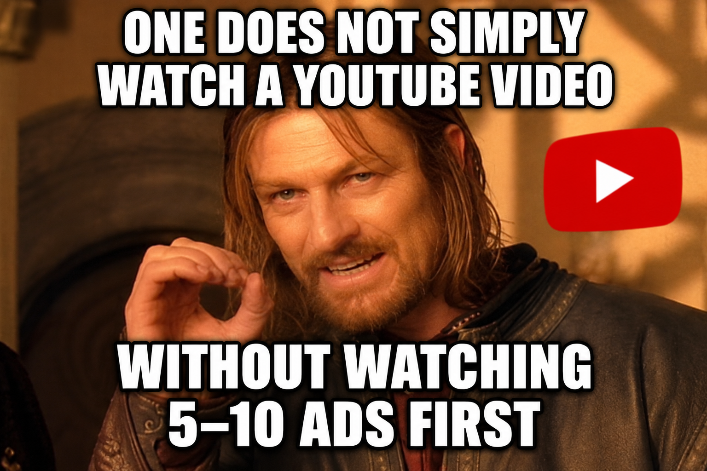

<div align="center">



### Requires [VLC Media Player](https://www.videolan.org/vlc/)

</div>

## Installation

### ⚙️ Windows Installer
> Download and run [```YouTubeDownloader_Setup.exe```](https://github.com/BBC-Esq/Youtube_Viewer_and_Downloader/releases/latest/download/YouTubeDownloader_Setup.exe).

### 💻 Within a Virtual Environment
> Download the latest release...unzip and extract...go to the directory containing ```main.py```...run these commands in order:
```
python -m venv .
```
```
.\Scripts\activate
```
```
python install.py
```

## Usage

```
.\Scripts\activate
```
```
python main.py
```
